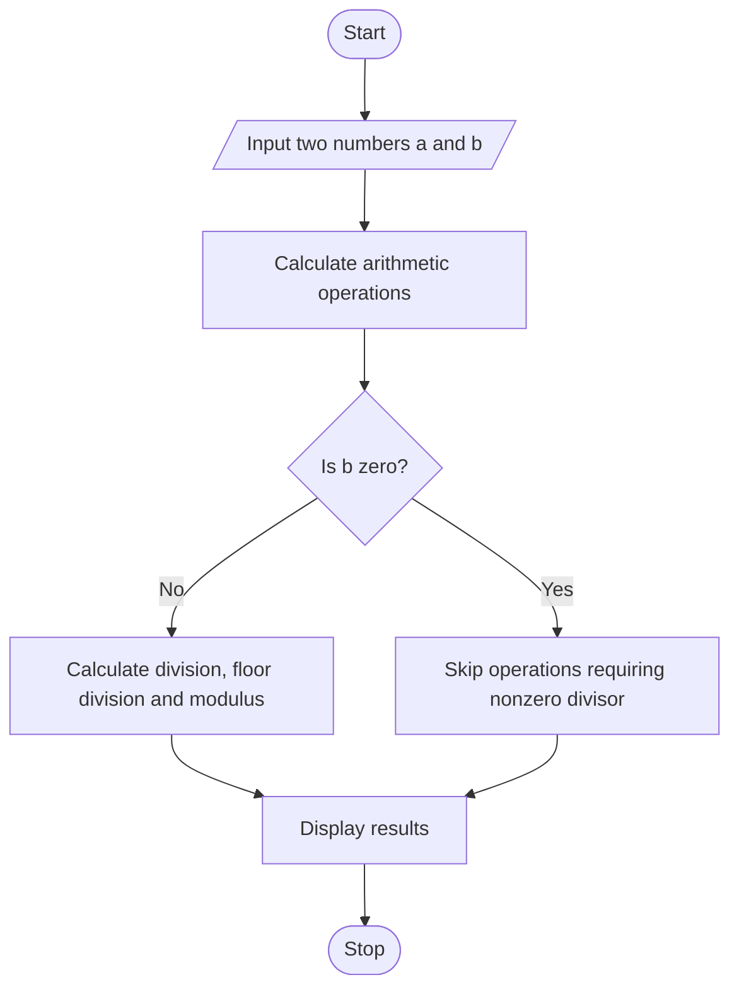

# Experiment 2: Arithmetic Operators in Python

## Aim
To write a Python program to demonstrate arithmetic operators.

## Python Code

```python
# --- Average calculation ---
X = 20
Y = 30
Z = 40
Average = (X + Y + Z) / 3
print("Average =", Average, "\n")

# --- Circle area and circumference ---
Radius = 20
Pi = 3.14
Area = Pi * (Radius ** 2)
Circumference = 2 * Pi * Radius
print("Area =", Area)
print("Circumference =", Circumference, "\n")

# --- Simple interest ---
Principal = float(input("Enter the principal amount (P): "))
Rate = float(input("Enter the annual interest rate (R): "))
Time = float(input("Enter the time period in years (T): "))
Simple_Interest = (Principal * Rate * Time) / 100
print("\nSimple Interest =", Simple_Interest, "\n")

# --- Compound amount ---
Principal = float(input("Enter the principal amount (P): "))
Rate = float(input("Enter the annual interest rate in % (R): "))
Time = float(input("Enter the time period in years (T): "))
Compound_Amount = Principal * (1 + Rate / 100) ** Time
Compound_Interest = Compound_Amount - Principal
print("\nCompound Interest =", Compound_Interest, "\n")
```

## Theory
Arithmetic operators perform mathematical calculations. The main operators are addition (`+`), subtraction (`-`), multiplication (`*`), division (`/`), floor division (`//`), modulus (`%`), and exponentiation (`**`). Division returns a floating-point result, floor division discards the fractional part toward negative infinity, modulus gives the remainder, and exponentiation raises one value to a power. Division and modulus by zero must be avoided.

## Algorithm
1. Start the program.
2. Accept two numeric values from the user.
3. Calculate addition, subtraction, multiplication, division, floor division, modulus, and exponentiation where valid.
4. Display each operation and its result.
5. Stop the program.

## Flowchart



## Conclusion
The program demonstrates the use of Python arithmetic operators and their results for numeric operands.

---
