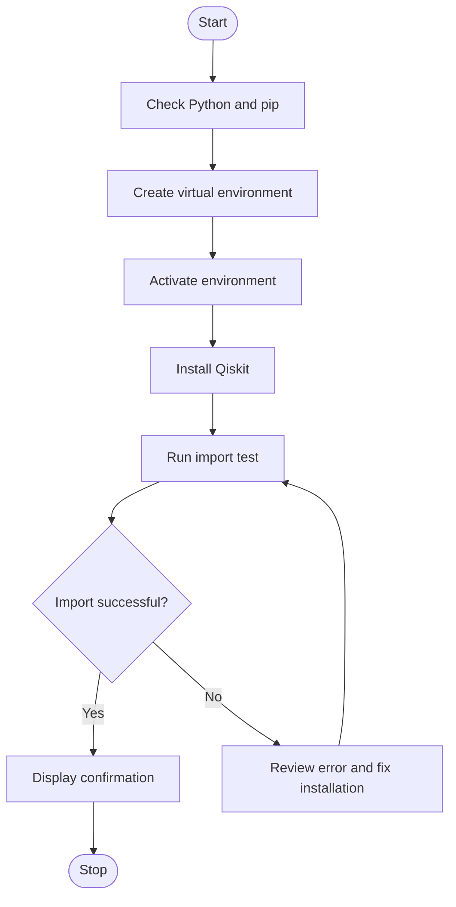

# Experiment 3: Installation and Configuration of the Qiskit Environment

## Aim
To install and configure the Qiskit environment and verify that the required Python packages can be imported.

## Python Code

The supplied code-extraction document does not contain a Qiskit installation/configuration code example for this experiment. Follow your lab instructor's installation steps or the official Qiskit documentation.

## Theory
Qiskit is a software development kit used to create and work with quantum-computing programs. A Python virtual environment helps isolate project dependencies. The environment can be created with `python -m venv .venv`, activated using the command appropriate for the operating system, and packages installed with `python -m pip install qiskit`. Package versions and installation instructions can change, so the current official Qiskit documentation should be checked if a command fails. A successful import confirms that Python can locate the installed package.

## Algorithm
1. Start.
2. Check that Python and pip are available in the terminal.
3. Create a virtual environment for the practical.
4. Activate the virtual environment.
5. Upgrade pip and install Qiskit using Python's package installer.
6. Run a short Python test that imports Qiskit and prints a confirmation or version information if available.
7. If an error occurs, read the message and correct the environment or installation.
8. Stop.

## Flowchart

## Conclusion
The Qiskit environment is configured and tested by importing the package in the selected Python environment.

---
