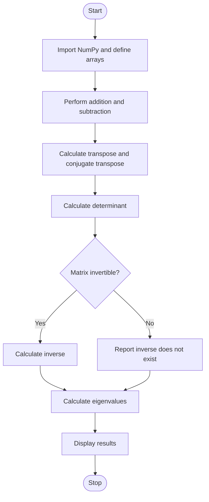

# Experiment 4: Basic Linear Algebra Operations for Quantum Computing

## Aim
To implement vectors, matrices, matrix addition and subtraction, transpose, conjugate transpose, determinant, inverse, and eigenvalues using Python and NumPy.

## Python Code

```python
# --- Program ---
import numpy as np

# Vector operations
v1 = np.array([1, 2, 3])
v2 = np.array([4, 5, 6])
print("Vector 1:", v1)
print("Vector 2:", v2)
print("\nVector Addition:", v1 + v2)
print("Vector Subtraction:", v1 - v2)

# Matrix operations
A = np.array([[1, 2], [3, 4]])
B = np.array([[5, 6], [7, 8]])
print("\nMatrix A:\n", A)
print("\nMatrix B:\n", B)
print("\nMatrix Addition:\n", A + B)
print("\nMatrix Subtraction:\n", A - B)
print("\nTranspose of A:\n", A.T)

# Conjugate transpose
C = np.array([[1 + 2j, 3 - 1j], [2 + 4j, 5 + 0j]])
print("\nComplex Matrix C:\n", C)
print("\nConjugate Transpose of C:\n", C.conj().T)

# Determinant, inverse, and eigenvalues
det_A = np.linalg.det(A)
print("\nDeterminant of A:", det_A)
inverse_A = np.linalg.inv(A)
print("\nInverse of A:\n", inverse_A)
eigenvalues, eigenvectors = np.linalg.eig(A)
print("\nEigenvalues:", eigenvalues)
```

## Theory
Linear algebra describes vectors and matrices used to represent quantum states and transformations. NumPy provides arrays and numerical linear-algebra functions. Matrix addition and subtraction require compatible shapes. The transpose swaps rows and columns. For a complex matrix, the conjugate transpose (Hermitian transpose) is the transpose after taking the complex conjugate of each element. A determinant and inverse are defined for square matrices; an inverse exists only when the determinant is nonzero. Eigenvalues describe scalars associated with nonzero eigenvectors satisfying \(Av=\lambda v\). Floating-point results may contain small numerical errors.

## Algorithm
1. Start the program and import NumPy.
2. Define example vectors and matrices, including a square matrix.
3. Display the vectors and matrices.
4. Perform matrix addition and subtraction on compatible matrices.
5. Calculate the transpose and conjugate transpose.
6. Calculate the determinant of a square matrix.
7. Check whether the determinant is sufficiently different from zero; if so, calculate the inverse.
8. Calculate and display the eigenvalues of the square matrix.
9. Stop.

## Flowchart



## Conclusion
The program demonstrates essential linear-algebra operations with NumPy and relates matrix calculations to mathematical tools used in quantum computing.

---
