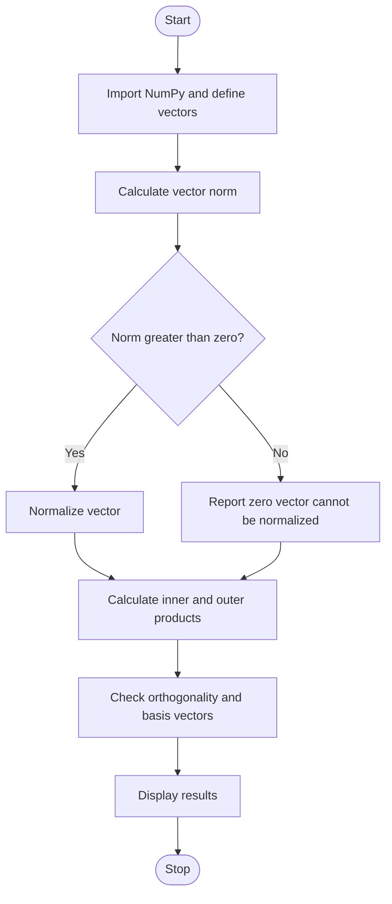

# Experiment 5: Vector Operations in Quantum State Representation

## Aim
To represent qubit states as vectors and implement normalization, inner product, outer product, magnitude, orthogonality, and basis-vector analysis.

## Python Code

```python
# --- Program ---
import numpy as np

v1 = np.array([1, 0], dtype=complex)
v2 = np.array([1, 1], dtype=complex)
print("Vector 1:", v1)
print("Vector 2:", v2)
print("\nMagnitude of Vector 1:", np.linalg.norm(v1))
print("Magnitude of Vector 2:", np.linalg.norm(v2))

v2_norm = v2 / np.linalg.norm(v2)
print("\nNormalized Vector 2:", v2_norm)
inner_product = np.vdot(v1, v2_norm)
print("\nInner Product:", inner_product)
outer_product = np.outer(v1, np.conjugate(v2_norm))
print("\nOuter Product:")
print(outer_product)

v3 = np.array([0, 1], dtype=complex)
inner_orthogonal = np.vdot(v1, v3)
print("\nVector 3:", v3)
print("Inner Product of Vector 1 and Vector 3:", inner_orthogonal)
if np.isclose(inner_orthogonal, 0):
    print("Vector 1 and Vector 3 are Orthogonal")
else:
    print("Vector 1 and Vector 3 are Not Orthogonal")

basis0 = np.array([1, 0], dtype=complex)
basis1 = np.array([0, 1], dtype=complex)
print("\nBasis Vectors:")
print("|0> =", basis0)
print("|1> =", basis1)
print("\nBasis Vector Inner Product:", np.vdot(basis0, basis1))
if np.isclose(np.vdot(basis0, basis1), 0):
    print("|0> and |1> are Orthogonal Basis Vectors")
```

## Theory
A qubit state is represented by a two-component complex vector, commonly written as \(|\psi\rangle = [\alpha,\beta]^T\), where a valid pure state satisfies \(|\alpha|^2+|\beta|^2=1\). Normalization scales a nonzero vector so that its norm is one. The inner product combines two vectors into a scalar; in complex vector spaces, the conjugate of the first vector is used. The outer product produces a matrix. Two vectors are orthogonal when their inner product is zero. The computational basis states are \(|0\rangle=[1,0]^T\) and \(|1\rangle=[0,1]^T\).

## Algorithm
1. Start and import NumPy.
2. Define one or more real or complex state vectors.
3. Calculate each vector's magnitude (norm).
4. Normalize any nonzero vector that is not already normalized.
5. Calculate the inner product and outer product for selected vectors.
6. Check orthogonality by testing whether the inner product is approximately zero.
7. Define and display the computational basis vectors.
8. Display all results and stop.

## Flowchart



## Conclusion
The program demonstrates vector calculations used to represent and analyze quantum states, including the normalization condition and orthogonality.

---
