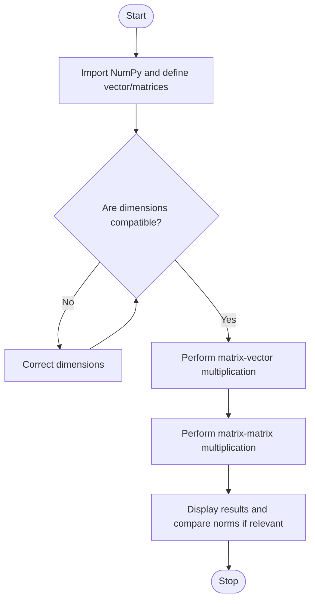

# Experiment 6: Matrix Multiplication for Quantum State Transformations

## Aim
To perform vector–matrix and matrix–matrix multiplication and observe how matrices transform state vectors.

## Python Code

```python
# --- Program ---
import numpy as np

state = np.array([[1], [0]])
print("Initial Quantum State:")
print(state)

H = (1 / np.sqrt(2)) * np.array([[1, 1], [1, -1]])
print("Hadamard Matrix:")
print(H)
state_after_H = np.dot(H, state)
print("State after applying Hadamard Gate:")
print(state_after_H)

X = np.array([[0, 1], [1, 0]])
print("Pauli-X Matrix:")
print(X)

combined_matrix = np.dot(X, H)
print("Matrix Multiplication (X x H):")
print(combined_matrix)
final_state = np.dot(combined_matrix, state)
print("Final Quantum State:")
print(final_state)
```

## Theory
Matrix multiplication combines linear transformations. If matrix \(A\) has shape \(m\times n\) and matrix \(B\) has shape \(n\times p\), then \(AB\) has shape \(m\times p\). The number of columns in the first matrix must equal the number of rows in the second. A quantum state vector can be transformed by applying an operator matrix, often written \(|\psi'\rangle=U|\psi\rangle\). Valid quantum gates are represented by unitary matrices, which preserve vector norm. Matrix multiplication is generally not commutative, so \(AB\) may differ from \(BA\).

## Algorithm
1. Start and import NumPy.
2. Define a state vector and a compatible transformation matrix.
3. Perform matrix–vector multiplication to obtain the transformed vector.
4. Define two compatible matrices and perform matrix–matrix multiplication.
5. Check and display the dimensions and results.
6. If using a unitary transformation, compare the input and output vector norms.
7. Stop.

## Flowchart



## Conclusion
The program demonstrates matrix multiplication and shows how a matrix can transform a state vector in a mathematical model of quantum state evolution.

---
