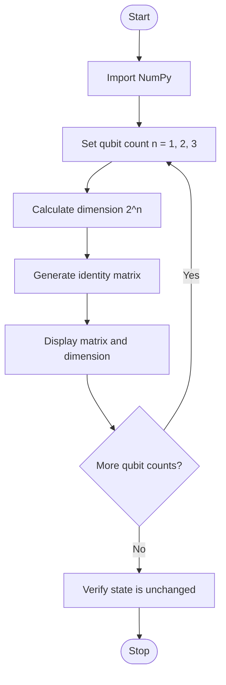

# Experiment 7: Identity Matrices for 1-Qubit, 2-Qubit, and 3-Qubit Systems

## Aim
To generate and analyze identity matrices for one-, two-, and three-qubit systems.

## Python Code

```python
# --- Program ---
import numpy as np

# 1-, 2-, and 3-qubit identity matrices
I1 = np.eye(2, dtype=int)
I2 = np.kron(I1, I1)
I3 = np.kron(I2, I1)
print("1-Qubit Identity Matrix:")
print(I1)
print("\n2-Qubit Identity Matrix:")
print(I2)
print("\n3-Qubit Identity Matrix:")
print(I3)

psi = np.array([1 / np.sqrt(2), 1 / np.sqrt(2)])
result = I1 @ psi
print("Original state:")
print(psi)
print("After applying identity:")
print(result)
print("State unchanged:", np.allclose(psi, result))

psi_2 = np.array([1, 2, 3, 4], dtype=float)
psi_2 = psi_2 / np.linalg.norm(psi_2)
result_2 = I2 @ psi_2
print("Original:", psi_2)
print("After identity:", result_2)
print("Unchanged:", np.allclose(psi_2, result_2))

psi_3 = np.ones(8, dtype=float)
psi_3 = psi_3 / np.linalg.norm(psi_3)
result_3 = I3 @ psi_3
print("Original state:")
print(psi_3)
print("\nAfter applying identity:")
print(result_3)
print("\nUnchanged:", np.allclose(psi_3, result_3))

X = np.array([[0, 1], [1, 0]])
check = X.conj().T @ X
print("X†X =")
print(check)
print("X is unitary:", np.allclose(check, I1))

XI = np.kron(X, I1)
print(XI)
```

## Theory
The identity matrix \(I_n\) is a square matrix with ones on the main diagonal and zeros elsewhere. Multiplying a compatible vector or matrix by an identity matrix leaves it unchanged. A system of \(n\) qubits has a state space of dimension \(2^n\), so the identity operator dimensions are \(2\times2\) for one qubit, \(4\times4\) for two qubits, and \(8\times8\) for three qubits. The identity operator is unitary and represents no change to the quantum state.

## Algorithm
1. Start and import NumPy.
2. Set the qubit counts to 1, 2, and 3.
3. For each qubit count n, calculate the dimension as \(2^n\).
4. Generate an identity matrix of that dimension using NumPy.
5. Display the qubit count, dimension, and matrix.
6. Optionally multiply a sample state vector by the identity and verify that it is unchanged.
7. Stop.

## Flowchart



## Conclusion
The identity matrices have dimensions 2×2, 4×4, and 8×8 for one, two, and three qubits respectively, and applying them preserves the represented state.

---
