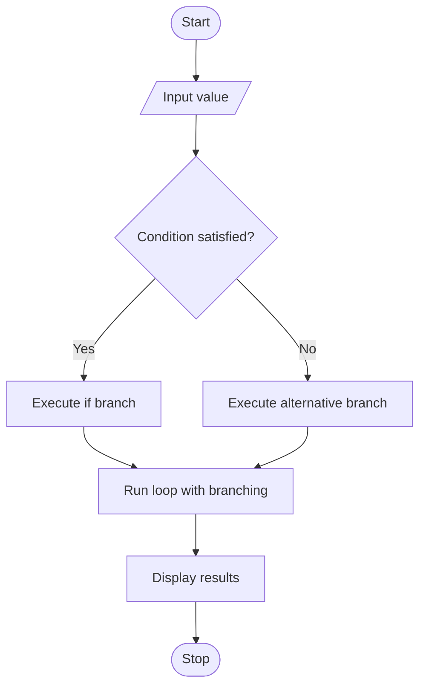

# Experiment 8: Control Structures in Python

## Aim
To write a program demonstrating conditional statements, loops, and branching statements in Python.

## Python Code

```python
# --- Largest of three numbers ---
A = int(input("Enter first number: "))
B = int(input("Enter second number: "))
C = int(input("Enter third number: "))
if A >= B and A >= C:
    print(f"\nThe largest number is: {A}\n")
elif B >= C:
    print(f"\nThe largest number is: {B}\n")
else:
    print(f"\nThe largest number is: {C}\n")

# --- Even or odd ---
Num = int(input("Enter a number: "))
if Num % 2 == 0:
    print("The number is Even.\n")
else:
    print("The number is Odd.\n")

# --- Positive, negative, or zero ---
Num = int(input("Enter a number: "))
if Num > 0:
    print("The number is Positive.\n")
elif Num < 0:
    print("The number is Negative.\n")
else:
    print("The number is Zero.\n")

# --- Leap year ---
Year = int(input("Enter a year: "))
if Year % 400 == 0 or (Year % 4 == 0 and Year % 100 != 0):
    print("Year is leap.\n")
else:
    print("Year is not leap.\n")

# --- Pass or fail ---
Marks = int(input("Enter the marks: "))
if Marks >= 35:
    print("Result: Pass\n")
else:
    print("Result: Fail\n")

# --- Largest of three numbers ---
A = float(input("Enter first number: "))
B = float(input("Enter second number: "))
C = float(input("Enter third number: "))
if A >= B and A >= C:
    print("The largest number is:", A, "\n")
elif B >= C:
    print("The largest number is:", B, "\n")
else:
    print("The largest number is:", C, "\n")

# --- Even or odd ---
Num = int(input("Enter a number: "))
if Num % 2 == 0:
    print("The number is Even.\n")
else:
    print("The number is Odd.\n")

# --- Positive, negative, or zero ---
Num = float(input("Enter a number: "))
if Num > 0:
    print("The number is Positive.\n")
elif Num < 0:
    print("The number is Negative.\n")
else:
    print("The number is Zero.\n")

# --- Pass or fail ---
Marks = float(input("Enter the student's marks: "))
if Marks >= 40:
    print("Result: Pass\n")
else:
    print("Result: Fail\n")

# --- Grade calculation ---
Marks = float(input("Enter the student's marks: "))
if Marks >= 90:
    print("Grade: A\n")
elif Marks >= 80:
    print("Grade: B\n")
elif Marks >= 70:
    print("Grade: C\n")
elif Marks >= 60:
    print("Grade: D\n")
else:
    print("Grade: F\n")

# --- Income tax calculation ---
Income = float(input("Enter your annual income: "))
if Income <= 250000:
    Tax = 0
elif Income <= 500000:
    Tax = (Income - 250000) * 0.05
elif Income <= 1000000:
    Tax = 12500 + (Income - 500000) * 0.20
else:
    Tax = 112500 + (Income - 1000000) * 0.30
print("Income Tax =", Tax, "\n")

# --- Print 1 to N ---
N = int(input("Enter a number: "))
for i in range(1, N + 1):
    print(i)
print("\n")

# --- Reverse while loop (N to 1) ---
N = int(input("Enter a number: "))
while N >= 1:
    print(N)
    N -= 1
print("\n")

# --- Multiplication table ---
Num = int(input("Enter a number: "))
i = 1
while i <= 10:
    print(Num, "x", i, "=", Num * i)
    i += 1
print("\n")

# --- Sum of first N natural numbers ---
N = int(input("Enter a number: "))
i = 1
Total = 0
while i <= N:
    Total += i
    i += 1
print("Sum of first", N, "natural numbers is:", Total, "\n")

# --- Factorial using a while loop ---
Num = int(input("Enter a number: "))
if Num < 0:
    print("Factorial is not defined for negative numbers.\n")
else:
    i = 1
    Fact = 1
    while i <= Num:
        Fact *= i
        i += 1
    print("Factorial of", Num, "is:", Fact, "\n")

# --- Count digits ---
Num = abs(int(input("Enter an integer: ")))
Count = 1 if Num == 0 else 0
while Num > 0:
    Num //= 10
    Count += 1
print("Number of digits:", Count, "\n")

# --- Reverse a number ---
Num = int(input("Enter a number: "))
Sign = -1 if Num < 0 else 1
Num = abs(Num)
Rev = 0
while Num > 0:
    Digit = Num % 10
    Rev = Rev * 10 + Digit
    Num //= 10
Rev *= Sign
print("Reversed number is:", Rev, "\n")

# --- Palindrome check ---
Num = int(input("Enter a number: "))
Original = Num
if Num < 0:
    print("Not a palindrome number\n")
else:
    Rev = 0
    while Num > 0:
        Digit = Num % 10
        Rev = Rev * 10 + Digit
        Num //= 10
    if Original == Rev:
        print("Palindrome number\n")
    else:
        print("Not a palindrome number\n")

# --- Sum of digits ---
Num = abs(int(input("Enter a number: ")))
Sum_Digits = 0
while Num > 0:
    Sum_Digits += Num % 10
    Num //= 10
print("Sum of digits:", Sum_Digits, "\n")

# --- Prime number check ---
def is_prime(n):
    if n <= 1:
        return False
    if n <= 3:
        return True
    if n % 2 == 0 or n % 3 == 0:
        return False
    i = 5
    while i * i <= n:
        if n % i == 0 or n % (i + 2) == 0:
            return False
        i += 6
    return True

Num = int(input("Enter a number: "))
if is_prime(Num):
    print(f"{Num} is a prime number.\n")
else:
    print(f"{Num} is not a prime number.\n")

# --- Prime numbers in a range ---
def is_prime_range(n):
    if n <= 1:
        return False
    for i in range(2, int(n ** 0.5) + 1):
        if n % i == 0:
            return False
    return True

Start = int(input("Enter start of range: "))
End = int(input("Enter end of range: "))
print(f"Prime numbers between {Start} and {End}:")
for num in range(Start, End + 1):
    if is_prime_range(num):
        print(num, end=" ")
print("\n")
```

## Theory
Control structures determine the order in which statements execute. Conditional statements (`if`, `elif`, and `else`) select a branch based on a Boolean condition. `for` loops iterate over a sequence or iterable, while `while` loops repeat as long as a condition remains true. `break` terminates the nearest loop, and `continue` skips to the next iteration. Correct indentation defines Python code blocks.

## Algorithm
1. Start the program.
2. Accept a value from the user.
3. Use an if–elif–else statement to classify or evaluate the value.
4. Use a for loop to process a range of values.
5. Demonstrate a while loop with a condition that eventually becomes false.
6. Use break or continue to demonstrate loop branching.
7. Display the results and stop.

## Flowchart



## Conclusion
The program demonstrates decision-making, iteration, and loop-control statements used to manage program execution.

---
