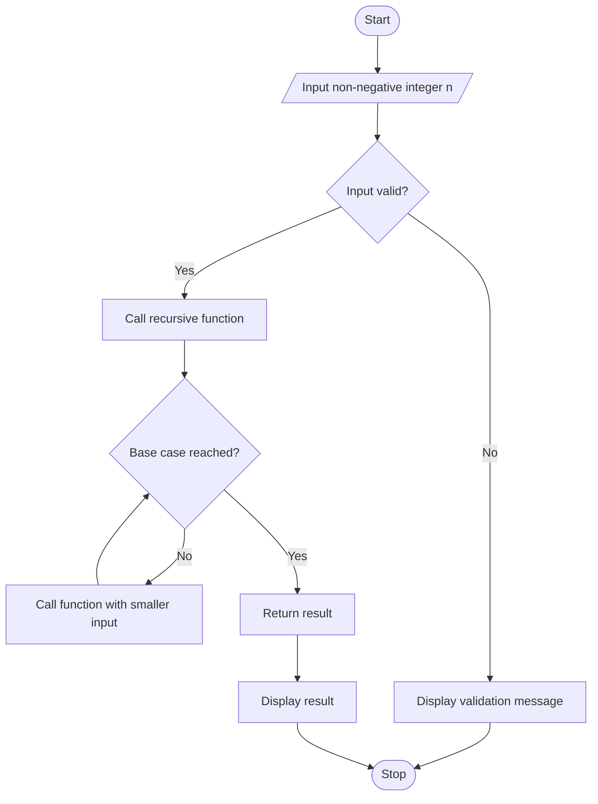

# Experiment 10: Recursion in Python

## Aim
To write a Python program demonstrating recursion by solving a problem with a function that calls itself.

## Python Code

```python
# --- Program ---
# Recursive Fibonacci function
def fibonacci(n):
    if n <= 1:
        return n
    return fibonacci(n - 1) + fibonacci(n - 2)

Terms = int(input("Enter number of terms: "))
print("Fibonacci Series:")
for i in range(Terms):
    print(fibonacci(i), end=" ")
print("\n\n")

# Recursive factorial function
def factorial_rec(n):
    if n == 0 or n == 1:
        return 1
    return n * factorial_rec(n - 1)

Num = int(input("Enter a number: "))
if Num < 0:
    print("Factorial is not defined for negative numbers.\n")
else:
    print("Factorial of", Num, "is", factorial_rec(Num), "\n")

# Recursive sum of digits
def sum_digits_rec(n):
    if n == 0:
        return 0
    return (n % 10) + sum_digits_rec(n // 10)

Num = abs(int(input("Enter a number: ")))
print("Sum of digits:", sum_digits_rec(Num), "\n")
```

## Theory
Recursion occurs when a function calls itself to solve a smaller version of a problem. A recursive solution needs a base case to stop further calls and a recursive case that moves toward the base case. For example, factorial can be defined as \(0!=1\) and \(n!=n(n-1)!\) for positive integers. Without a correct base case, recursion may continue until Python raises a recursion-depth error. Input validation is important for problems with restricted domains.

## Algorithm
1. Start the program.
2. Accept a non-negative integer from the user.
3. Define a recursive function with a base case.
4. In the recursive case, call the function with a smaller input.
5. Call the function using the supplied input.
6. Display the result and stop.

## Flowchart



## Conclusion
The program demonstrates recursion and highlights the importance of a base case and progress toward that base case.

---
