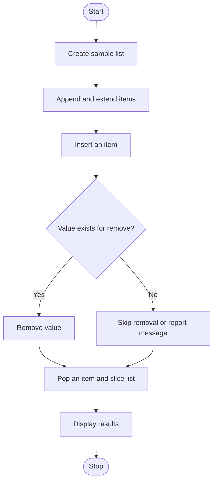

# Experiment 11: List Operations: Append, Extend, Insert, Remove, Pop, and Slice

## Aim
To perform common Python list operations: append, extend, insert, remove, pop, and slicing.

## Python Code

```python
# --- Program ---
# Append
A = [2, 3, 4, 5, 6, 9, 8]
A.append(10)
print("A =", A, "\n")

# Insert
A = [45, 67, 44, 14, 22, 13]
A.insert(3, 50)
print("A =", A, "\n")

# Delete by index (pop)
A = [22, 45, 14, 5, 67, 88]
A.pop(4)
print("A =", A, "\n")

# Remove by value
A = [45, 67, 33, 69, 39, 40]
A.remove(40)
print("A =", A, "\n")

# Slicing
A = [12, 46, 67, 33, 45, 22, 90, 55]
Slice_Start = A[0:7]
print("Slice:", Slice_Start, "\n")

# Extend
A = [22, 45, 5, 78, 14, 60]
B = [1, 2, 4, 10]
A.extend(B)
print("Extended A:", A, "\n")

# Indexing
A = [12, 23, 34, 56, 67, 78]
print("Element at index 4:", A[4], "\n")

# Concatenation
A = [44, 56, 67, 12, 34]
B = [50, 34, 22, 1]
print("Concatenation:", A + B, "\n")

# Repetition
A = [20, 30, 40]
print("Repetition:", A * 4, "\n")

# Updating
A = [34, 2, 12, 66, 7, 98]
print("Before update element at index 2:", A[2])
A[2] = 80
print("Updated A:", A, "\n")

# Membership
A = [23, 44, 36, 88, 79]
print("Is 5 in A?", 5 in A, "\n")

# Comparison
A = [33, 4, 5, 13, 88]
B = [45, 56, 7, 78]
print("Is A != B?", A != B, "\n")

# Sorting
A = [3, 5, 9, 4, 2, 7, 6]
A.sort()
print("Sorted A:", A, "\n")

# Reversing
B = [78, 68, 33, 90, 34, 14, 44]
B.reverse()
print("Reversed B:", B, "\n")

# Count, copy, length, sum, maximum, clear, and delete
A = [4, 6, 9, 7, 2, 8, 9]
print("Count of 9 in A:", A.count(9), "\n")
A = [2, 3, 4, 5, 5, 6, 7, 7, 8]
B = A.copy()
print("Copied B:", B, "\n")
A = [4, 5, 6, 778, 89, 23]
print("Length of A:", len(A), "\n")
A = [22, 45, 6, 3, 21, 2]
print("Sum of A:", sum(A), "\n")
A = [23, 88, 98, 786, 14, 2]
print("Maximum in A:", max(A), "\n")
A = [23, 4, 5, 67, 78, 90]
A.clear()
print("Cleared A:", A, "\n")
A = [3, 54, 56, 67, 78, 98]
del A[3]
print("After deleting element at index 3:", A, "\n")
```

## Theory
A list is an ordered, mutable collection that can contain items of different types. `append(x)` adds one item to the end; `extend(iterable)` adds each item from an iterable; `insert(i, x)` inserts at an index; `remove(x)` removes the first matching value; and `pop(i)` removes and returns the item at an index (the last item by default). Slicing, such as `items[start:stop]`, creates a sublist. Invalid indices or missing values can raise exceptions, so the list should be checked before removal or popping.

## Algorithm
1. Start and create a sample list.
2. Append an item to the list.
3. Extend the list with multiple items.
4. Insert an item at a specified index.
5. Remove a value that exists in the list.
6. Pop an item from a valid index or from the end.
7. Display a slice of the list and the final list.
8. Stop.

## Flowchart



## Conclusion
The program demonstrates common list methods and slicing for modifying and accessing ordered, mutable data.

---
