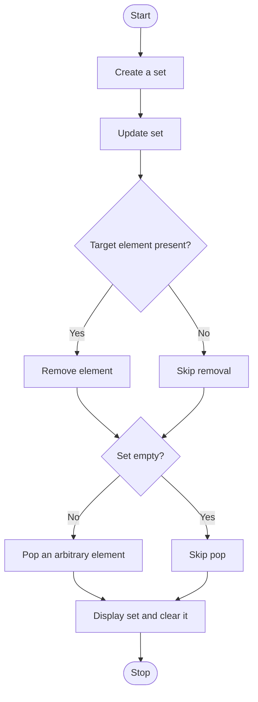

# Experiment 12: Set Operations: Update, Remove, Clear, and Pop

## Aim
To demonstrate Python set operations including update, removing an element, clear, and pop.

## Python Code

```python
# --- Set Creation ---
# Create set from list
print("--- Set Creation ---")
List1 = [1, 2, 2, 3, 4, 4, 5]
Set1 = set(List1)
print("Set from list:", Set1, "\n")

# --- Set Element Search ---
# Element search in set
print("--- Set Element Search ---")
Set1 = {"apple", "banana", "cherry"}
if "banana" in Set1:
    print("Element Found\n")
else:
    print("Element Not Found\n")

# --- Set Difference ---
# Set difference
print("--- Set Difference ---")
Set1 = {1, 2, 3, 4}
Set2 = {3, 4, 5, 6}
print("Difference (Set1 - Set2):", Set1.difference(Set2), "\n")

# --- Set Union ---
# Set union
print("--- Set Union ---")
Set1 = {1, 2, 3}
Set2 = {3, 4, 5}
print("Union:", Set1.union(Set2), "\n")

# --- Set Intersection ---
# Set intersection
print("--- Set Intersection ---")
Set1 = {1, 2, 3}
Set2 = {2, 3, 4}
print("Intersection:", Set1.intersection(Set2), "\n")
```

## Theory
A set is an unordered collection of unique hashable elements. Duplicate values are automatically removed. `update(iterable)` adds multiple elements. `remove(x)` deletes a specified element but raises `KeyError` if it is absent; `discard(x)` can be used when absence should not raise an error. `pop()` removes and returns an arbitrary element because sets have no fixed order. `clear()` removes all elements from the set.

## Algorithm
1. Start and create a set with sample values.
2. Update the set with one or more values.
3. Check whether the target element exists and remove it if present.
4. If the set is not empty, pop an arbitrary element and display it.
5. Display the current set.
6. Clear the set and display the empty result.
7. Stop.

## Flowchart



## Conclusion
The program demonstrates how sets add, remove, and clear unique elements while maintaining no guaranteed order.

---
