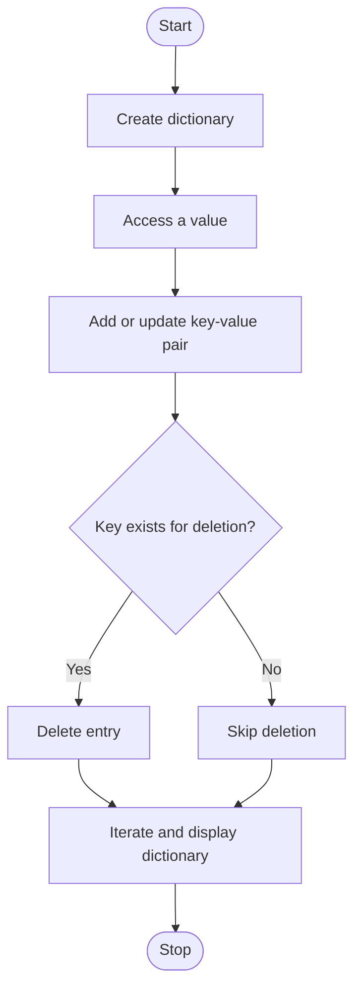

# Experiment 14: Dictionary in Python

## Aim
To write a Python program demonstrating the creation, access, update, deletion, and iteration of dictionary items.

## Python Code

```python
# --- Program ---
# Create a dictionary and display all keys and values
Student = {"Roll No": 42, "Name": "David", "Age": 21, "Location": "Seattle"}
print("Student Details:")
for Key, Value in Student.items():
    print(Key, ":", Value)

# --- Program ---
# Access values using keys
Student = {"Roll No": 42, "Name": "David", "Age": 21, "Location": "Seattle"}
print("Roll No:", Student["Roll No"])
print("Name:", Student["Name"])
print("Age:", Student["Age"])
print("Location:", Student["Location"], "\n")

# --- Program ---
# Count key-value pairs
Student = {"Roll No": 42, "Name": "David", "Age": 21, "Location": "Seattle"}
print("Total key-value pairs:", len(Student), "\n")

# --- Program ---
# Check whether a key exists
Student = {"Roll No": 42, "Name": "David", "Age": 21, "Location": "Seattle"}
Key_Search = input("Enter key to search: ")
if Key_Search in Student:
    print("Key exists in dictionary\n")
else:
    print("Key does not exist in dictionary\n")

# --- Program ---
# Update an existing value
Student = {"Roll No": 42, "Name": "David", "Age": 21, "Location": "Seattle"}
Student["Age"] = 20
print("Updated dictionary:", Student, "\n")

# --- Program ---
# Add a key-value pair
Student = {"Roll No": 42, "Name": "David", "Age": 21, "Location": "Seattle"}
Student["Gender"] = "Female"
print("Updated dictionary:", Student, "\n")

# --- Program ---
# Delete a specific key
Student = {"Roll No": 42, "Name": "David", "Age": 21, "Location": "Seattle"}
del Student["Location"]
print("Dictionary after deletion:", Student, "\n")

# --- Program ---
# Remove the last inserted key-value pair
Student = {"Roll No": 42, "Name": "David", "Age": 21, "Location": "Seattle"}
Removed = Student.popitem()
print("Removed item:", Removed)
print("Dictionary:", Student, "\n")

# --- Program ---
# Clear all dictionary entries
Student = {"Roll No": 42, "Name": "David", "Age": 21, "Location": "Seattle"}
Student.clear()
print("Dictionary after clearing:", Student, "\n")

# --- Program ---
# Display all key-value pairs with items()
Student = {"Roll No": 42, "Name": "David", "Course": "Computer Science", "CGPA": 8.5}
for Key, Value in Student.items():
    print(Key, ":", Value)

# --- Program ---
# Display all keys
Student = {"Roll No": 42, "Name": "David", "Course": "Computer Science", "CGPA": 8.5}
print("Keys:", Student.keys(), "\n")

# --- Program ---
# Display keys using a loop
Student = {"Roll No": 42, "Name": "David", "Course": "Computer Science", "CGPA": 8.5}
for Key in Student.keys():
    print(Key)

# --- Program ---
# Display all values
Student = {"Roll No": 42, "Name": "David", "Course": "Computer Science", "CGPA": 8.5}
for Value in Student.values():
    print(Value)

# --- Program ---
# Sum numeric values
Marks = {"Maths": 80, "Physics": 75, "Chemistry": 85, "Python": 90}
Total = sum(Marks.values())
print("Sum of values:", Total, "\n")

# --- Program ---
# Find maximum and minimum values
Marks = {"Maths": 80, "Physics": 75, "Chemistry": 85, "Python": 90}
Maximum = max(Marks.values())
Minimum = min(Marks.values())
print("Maximum value:", Maximum)
print("Minimum value:", Minimum, "\n")

# --- Program ---
# Reverse dictionary item order
Student = {"Roll No": 42, "Name": "David", "Course": "Computer Science", "CGPA": 8.5}
Reverse = dict(reversed(list(Student.items())))
print("Original dictionary:", Student)
print("Reversed dictionary:", Reverse, "\n")
```

## Theory
A dictionary stores key–value pairs. Keys must be hashable and are unique; assigning a value to an existing key updates that entry. Values can be accessed using `dict[key]` or safely with `dict.get(key)`. New pairs can be added by assignment, existing pairs updated, and entries removed using `del` or `pop()`. Methods such as `keys()`, `values()`, and `items()` support iteration over dictionary content.

## Algorithm
1. Start and create a dictionary with sample key–value pairs.
2. Access and display a value using its key or `get()`.
3. Add a new key–value pair.
4. Update the value for an existing key.
5. Check that a key exists before deleting it.
6. Iterate over the dictionary and display its keys and values.
7. Stop.

## Flowchart



## Conclusion
The program demonstrates dictionary operations for storing and managing data as key–value pairs.

---
