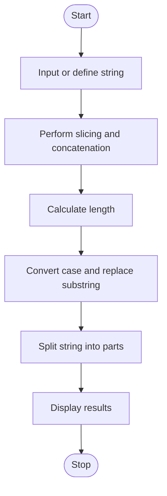

# Experiment 15: String Operations: Slicing, Concatenation, Length, Case Conversion, Replace, and Split

## Aim
To demonstrate common Python string operations including slicing, concatenation, length, case conversion, replacement, and splitting.

## Python Code

```python
# --- Program ---
# List slicing (as shown in source)
Numbers = [10, 20, 30, 40, 50, 60]
print("Sliced list:", Numbers[1:4], "\n")

# --- Program ---
# String concatenation
First = "Hello"
Second = "Python"
Result = First + " " + Second
print("Concatenation:", Result, "\n")

# --- Program ---
# String length
A = "college"  # Corrected spelling from source's "collage".
print("Length of string:", len(A))
print("String:", A, "\n")

# --- Program ---
# Uppercase and lowercase conversions
First = "Hello"
Second = "Alex"
Result = First + " " + Second
print("Uppercase:", Result.upper())
print("Lowercase:", Result.lower(), "\n")

# --- Program ---
# Replace substring
Text = "Hello World"
Text = Text.replace("World", "Python")
print("Replaced string:", Text, "\n")

# --- Program ---
# Count vowels, consonants, digits, and other characters
Text = input("Enter a string: ")
Vowels = Consonants = Digits = Special = 0
for Ch in Text:
    if Ch.isalpha():
        if Ch.lower() in "aeiou":
            Vowels += 1
        else:
            Consonants += 1
    elif Ch.isdigit():
        Digits += 1
    else:
        Special += 1
print("Vowels:", Vowels)
print("Consonants:", Consonants)
print("Digits:", Digits)
print("Special Characters:", Special, "\n")

# --- Program ---
# Frequency of a specific character
Text = input("Enter a string: ")
Ch = input("Enter character to find: ")
Count = 0
for C in Text:
    if C == Ch:
        Count += 1
print("Frequency of", Ch, "is:", Count, "\n")

# --- Program ---
# Count words starting with a vowel
Sentence = input("Enter a sentence: ")
Words = Sentence.split()
Count = sum(1 for Word in Words if Word[0].lower() in "aeiou")
print("Words starting with a vowel:", Count, "\n")

# --- Program ---
# Find longest and shortest word
Sentence = input("Enter a sentence: ")
Words = Sentence.split()
if not Words:
    print("No words were entered.")
else:
    Longest = max(Words, key=len)
    Shortest = min(Words, key=len)
    print("Longest word:", Longest)
    print("Shortest word:", Shortest, "\n")

# --- Program ---
# Find most frequent character
Text = input("Enter a string: ")
if not Text:
    print("No characters were entered.")
else:
    Most_Frequent = max(set(Text), key=Text.count)
    print("Most frequent character:", Most_Frequent)
    print("Frequency:", Text.count(Most_Frequent), "\n")

# --- Program ---
# Count words in a sentence
Sentence = input("Enter a sentence: ")
Words = Sentence.split()
print("Number of words:", len(Words), "\n")

# --- Program ---
# Find duplicate words
Sentence = input("Enter a sentence: ")
Words = Sentence.lower().split()
Duplicates = []
for Word in Words:
    if Words.count(Word) > 1 and Word not in Duplicates:
        Duplicates.append(Word)
print("Duplicate words:", Duplicates, "\n")

# --- Program ---
# Remove duplicate words while preserving order
Sentence = input("Enter a sentence: ")
Words = Sentence.split()
Result = list(dict.fromkeys(Words))
New_Sentence = " ".join(Result)
print("After removing duplicates:")
print(New_Sentence, "\n")

# --- Program ---
# Reverse each word in a sentence
Sentence = input("Enter a sentence: ")
Words = Sentence.split()
Result = [Word[::-1] for Word in Words]
New_Sentence = " ".join(Result)
print("Reversed words:")
print(New_Sentence, "\n")

# --- Program ---
# Basic email validation
Email = input("Enter email address: ")
if (
    "@" in Email
    and "." in Email
    and Email.count("@") == 1
    and not Email.startswith("@")
    and not Email.endswith("@")
    and not Email.startswith(".")
    and not Email.endswith(".")
):
    print("Valid email address\n")
else:
    print("Invalid email address\n")
```

## Theory
A string is an immutable sequence of Unicode characters. `len()` returns its number of characters. Slicing selects a substring using start and stop indices. The `+` operator concatenates strings. `upper()` and `lower()` return case-converted strings; `replace(old, new)` returns a string with matching substrings replaced; and `split()` divides a string into a list, using whitespace by default or a specified separator. These methods return new values rather than modifying the original string.

## Algorithm
1. Start and define or accept a string.
2. Display a selected substring using slicing.
3. Concatenate the string with another string.
4. Calculate and display its length.
5. Display uppercase and lowercase versions.
6. Replace a selected substring with another substring.
7. Split the string into a list of parts and display it.
8. Stop.

## Flowchart



## Conclusion
The program demonstrates important string-processing operations and shows that string methods return transformed results without changing the original string.

---
