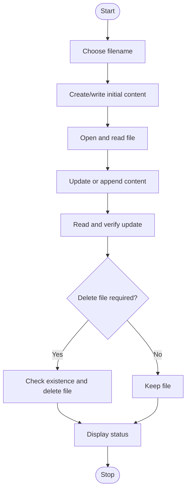

# Experiment 16: File Operations: Create, Open, Read, Write, Update, and Delete

## Aim
To demonstrate basic file operations in Python: creating, opening, reading, writing, updating, and deleting a file.

## Python Code

```python
# --- Program ---
# Read a file if it exists
import os

filename = "student.txt"
if os.path.exists(filename):
    with open(filename, "r") as file:
        print(file.read())
else:
    print("File does not exist.")

# --- Program ---
# Read the first three lines
filename = "student.txt"
with open(filename, "r") as file:
    for i in range(3):
        line = file.readline()
        if line == "":
            break
        print(line, end="")

# --- Program ---
# Read the last three lines
filename = "student.txt"
with open(filename, "r") as file:
    lines = file.readlines()
for line in lines[-3:]:
    print(line, end="")

# --- Program ---
# Read the last three lines (repeated example in source)
filename = "student.txt"
with open(filename, "r") as file:
    lines = file.readlines()
for line in lines[-3:]:
    print(line, end="")

# --- Program ---
# Count lines, words, and characters
with open("student.txt") as f:
    data = f.read()
print("No. of Lines:", len(data.splitlines()))
print("No. of Words:", len(data.split()))
print("No. of Characters:", len(data))

# --- Program ---
# Count digits and special characters
with open("student.txt") as f:
    data = f.read()
print("Digits:", sum(c.isdigit() for c in data))
print("Special characters:", sum(not c.isalnum() and not c.isspace() for c in data))

# --- Program ---
# Replace a word in a file
with open("student.txt") as f:
    data = f.read()
data = data.replace(input("Old word: "), input("New word: "))
with open("student.txt", "w") as f:
    f.write(data)

# --- Program ---
# Replace a sentence or phrase in a file
with open("student.txt") as f:
    data = f.read()
data = data.replace(input("Old sentence: "), input("New sentence: "))
with open("student.txt", "w") as f:
    f.write(data)

# --- Program ---
# Find longest and shortest lines
with open("student.txt") as f:
    lines = f.readlines()
if lines:
    print("Longest:", max(lines, key=len))
    print("Shortest:", min(lines, key=len))
else:
    print("The file is empty.")

# --- Program ---
# Most common word
from collections import Counter

with open("student.txt") as f:
    words = f.read().lower().split()
print(Counter(words).most_common(1))

# --- Program ---
# Compare two files
file1 = "student.txt"
file2 = "data.txt"
with open(file1, "r") as f1:
    content1 = f1.read()
with open(file2, "r") as f2:
    content2 = f2.read()
if content1 == content2:
    print("Both files have the same content.")
else:
    print("The files have different content.")

# --- Program ---
# Combine two files into combined.txt
files = ["student.txt", "data.txt"]
with open("combined.txt", "w") as output:
    for filename in files:
        with open(filename, "r") as file:
            output.write(file.read())
            output.write("\n")
print("Files combined successfully into combined.txt")
```

## Theory
File handling allows a program to store data beyond a single execution. Python's `open()` function accepts a filename and mode. Common modes include `r` for reading, `w` for writing (creating or truncating a file), `a` for appending, and `r+` for reading and writing. A `with open(...)` block closes the file automatically. Updating content may involve reading existing text and rewriting it, or appending new text. A file should be closed before deletion; `os.remove()` deletes a file and may raise an error if it does not exist.

## Algorithm
1. Start the program and choose a filename.
2. Create or write initial text to the file using a suitable mode.
3. Open the file in read mode and display its contents.
4. Update the file by appending text or by reading and rewriting the contents.
5. Read the file again to verify the update.
6. Close the file using a context manager and, if the practical requires it, delete the file after checking that it exists.
7. Display the operation status and stop.

## Flowchart



## Conclusion
The program demonstrates the file lifecycle, including creating, reading, writing, updating, and optionally deleting a file. File modes should be selected carefully to avoid unintentionally overwriting data.

---
